# Ferramentas para medir uso (tokens) e custo de IA por funcionário, conta e projeto

Pesquisa feita em 01/11/2026. Os prints estão na pasta `prints/` e estão numerados na ordem em que aparecem aqui.

## Resposta curta

Sim, existem ferramentas, e elas se dividem em três camadas. Nenhuma camada sozinha responde todas as suas perguntas.

| Camada | O que é | Exemplos | Responde o quê |
|---|---|---|---|
| 1. Painel nativo do fornecedor | Console de administração do próprio Claude, Gemini, ChatGPT, Copilot | Claude Enterprise Analytics, Google Admin Gemini reports, ChatGPT Enterprise Workspace Analytics, Viva Copilot Dashboard | Quem usa, quanto usa e (só no Claude) quanto custa, dentro da conta corporativa daquele fornecedor |
| 2. Gateway / observabilidade de API | Um proxy por onde passam as chamadas de API que a empresa desenvolve | LiteLLM, Portkey, Helicone, Langfuse, OpenMeter | Custo por chave, usuário, time, projeto e modelo, com orçamento e bloqueio, em qualquer fornecedor |
| 3. Governança de SaaS / FinOps de IA | Plataforma que junta SSO, cartão corporativo, extensão de navegador e as APIs das camadas 1 e 2 | Torii, CloudEagle, Zylo, Vantage, Finout, CloudZero | Visão única multi-fornecedor, descoberta de contas pessoais pagas pela empresa, chargeback por departamento |

## As suas perguntas, uma a uma

**Quem está usando quais contas?** Dentro de uma conta corporativa, o painel do fornecedor mostra cada membro e o assento dele. Para contas individuais (Claude Pro/Max, Gemini Advanced pessoal, ChatGPT Plus) o fornecedor não expõe nada para a empresa. Só uma ferramenta da camada 3 enxerga isso, cruzando despesas de cartão, logins por SSO ou OAuth e extensão de navegador.

**Qual usuário está usando mais?** Claude Enterprise, ChatGPT Enterprise e Google Admin mostram ranking de membros por uso. Só o Claude mostra o custo por pessoa. O Google mostra nível de uso (alto, médio, baixo) e dias no limite, sem tokens nem valor.

**Qual o custo?** Claude Enterprise: custo por usuário, grupo, produto e modelo, com exportação em CSV e API. Gemini no Workspace: não há custo por usuário, é licença fixa por assento. Gemini via API (Vertex AI): custo por projeto GCP e por rótulo (label) nas chamadas, exportado para BigQuery. ChatGPT Enterprise: mensagens por usuário, sem custo em dólar.

**Em qual projeto?** Claude: a API de Analytics tem dimensão de projeto do Claude Chat e grupos SCIM. Vertex AI: projeto GCP e labels. Nos gateways: tag ou metadado por requisição. Camada 3: centro de custo mapeado do RH ou do SSO.

**Outros usuários no Gemini pago, quem está usando?** Se for Gemini do Google Workspace, o Admin Console lista por usuário. Se for Gemini Advanced em conta pessoal, só a camada 3 descobre, pelo cartão ou pelo navegador.

## Camada 1: painéis nativos

### Claude (Anthropic)

O Claude é hoje o fornecedor com a visão mais completa de custo por pessoa. O artigo da Anthropic de julho de 2026 descreve: custo por usuário e por grupo SCIM, limite de gasto por organização e por grupo, alertas em 75% e 90%, modelo padrão por função, chat de analytics em linguagem natural e uma Analytics API com `read:analytics` para integrar com Datadog, CloudZero e Vantage.

A exportação "spend report" gera um CSV com uma linha por pessoa por modelo: e-mail, produto, modelo, requisições, tokens de entrada, tokens de saída, gasto líquido e gasto bruto em dólar.

Quem vê: no plano Team, Owners. No Enterprise, Owners e Admins. A Analytics API só existe no Enterprise. Planos Pro e Max individuais não têm nada disso.

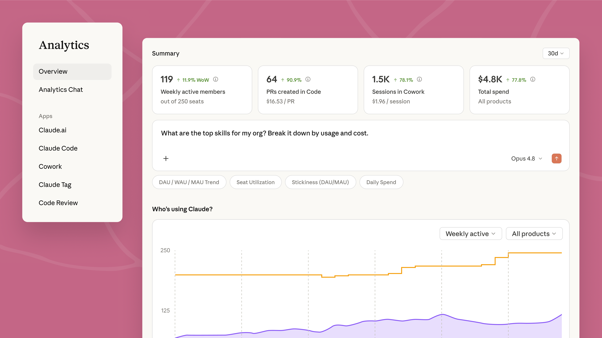
Print 1. Painel de admin do Claude Enterprise: membros ativos, PRs no Claude Code, sessões no Cowork, gasto total e o chat de analytics.

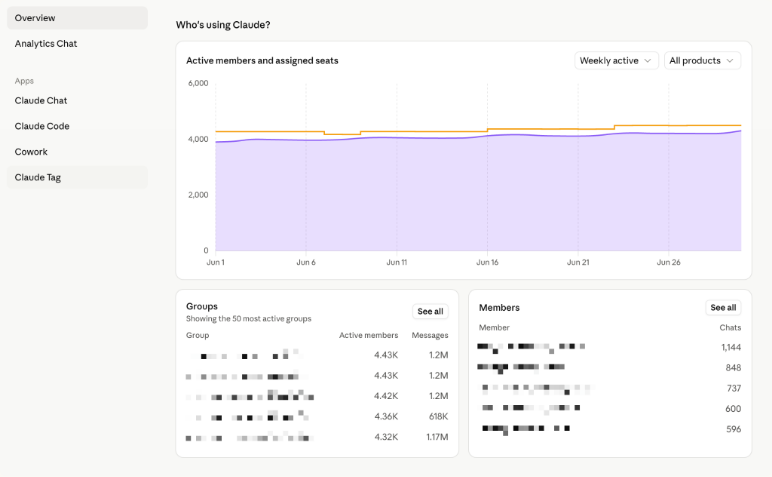
Print 2. Seção "Who's using Claude?": membros ativos contra assentos, ranking de grupos e de membros.

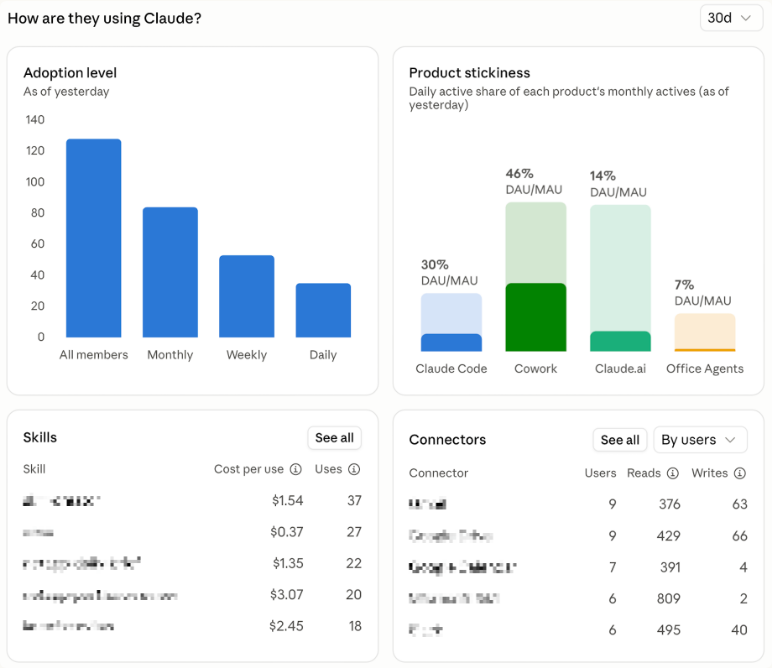
Print 3. Adoção por produto, custo por uso de cada skill e conectores usados.

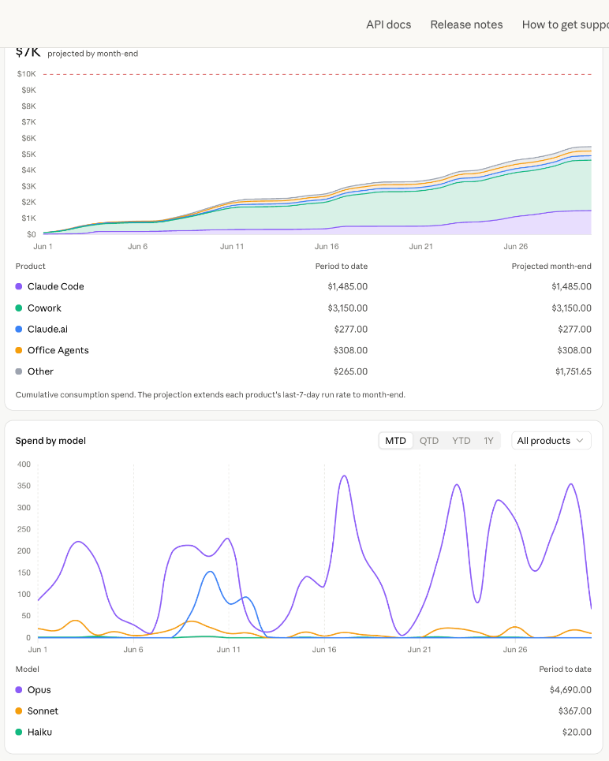
Print 4. Gasto acumulado por produto (Claude Code, Cowork, Claude.ai, Office Agents) com projeção e gasto por modelo.

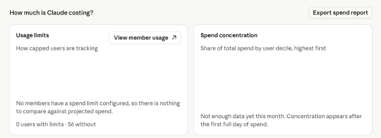
Print 5. Bloco "How much is Claude costing?" com limites por membro, concentração de gasto e o botão de exportar o spend report.

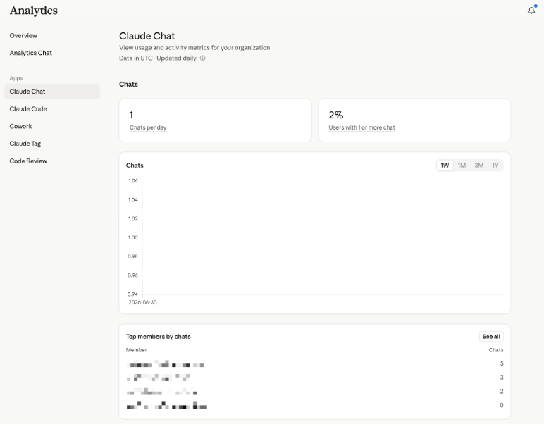
Print 6. Aba Claude Chat com ranking de membros por chats.

Para quem usa a API do Claude direto (Console), existe outro caminho: a Usage and Cost API e o painel do Claude Code em platform.claude.com, que mostra gasto por usuário no mês. Usuários por chave de API aparecem pelo identificador da chave, então para ter custo por pessoa é preciso uma chave por pessoa ou login OAuth.

### Gemini (Google)

No Google Workspace, o Admin Console tem "Gemini reports" com visão por organização e por usuário: usuários ativos, uso por app (Gmail, Docs, Slides, Sheets, app Gemini), nível de uso de cada pessoa nos últimos 28 dias, dias no limite, e exportação para planilha. Não mostra tokens nem custo, porque a cobrança é por licença. Há atraso de 2 a 3 dias. Os logs de auditoria do Gemini também saem pela Reporting API do Admin SDK.

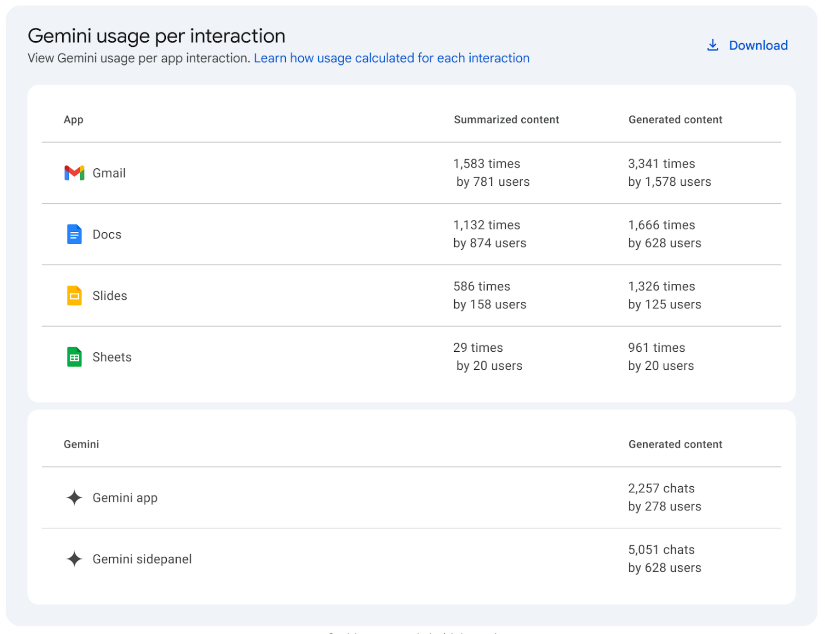
Print 7. Relatório do Admin Console: uso do Gemini por app e por quantos usuários.

Para Gemini via API, a visibilidade vem do billing do Google Cloud. Cada projeto GCP vira um centro de custo. Nas chamadas ao Vertex AI dá para anexar até 64 labels (time, projeto, usuário) e agrupar por eles no relatório de billing ou no export para BigQuery. Chaves do Google AI Studio não aceitam labels, então todas as chaves de um projeto caem num total só.

### ChatGPT Enterprise (OpenAI)

Workspace Analytics mostra usuários ativos, mensagens, GPTs, ferramentas e projetos, segmentável por grupo quando há SCIM, com exportação por usuário em CSV de até 12 meses. Não mostra custo em dólar. Para registros brutos existe a Compliance API. Não consegui capturar print porque a central de ajuda da OpenAI bloqueou o acesso automatizado.

### Microsoft 365 Copilot

O Copilot Dashboard do Viva Insights mostra adoção por app, time e departamento. Dados por pessoa são anonimizados por padrão. Em 2026 a Microsoft adicionou o Agent Dashboard com consumo de créditos de agentes e "cost management insights" para Cowork e WorkIQ.

## Camada 2: gateways e observabilidade de API

Servem para o que a empresa constrói sobre as APIs. A equipe troca a URL base do SDK pela do gateway, e cada requisição passa a ser registrada com tokens, custo, modelo, chave, usuário, time e tags. Não enxergam o que as pessoas fazem no claude.ai ou no app do Gemini.

- **LiteLLM** (open source, auto-hospedado): registra gasto por chave, usuário interno, time, usuário final e tag em Postgres. Tem orçamento com bloqueio por chave, usuário e time, relatórios agrupados por time ou cliente, e métricas Prometheus. Funciona com Claude, Gemini, OpenAI, Bedrock e outros.
- **Portkey**: gateway comercial com chaves virtuais. Orçamento em dólar ou tokens por chave e por workspace, com alerta antes do limite e reset semanal ou mensal. Registra mais de 40 métricas por requisição.
- **Helicone**: proxy open source. Headers customizados segmentam por usuário, funcionalidade ou cliente.
- **Langfuse**: traço por chamada via SDK, com custo em dólar por modelo, usuário, ambiente e caso de uso. É observabilidade, não impõe limite.
- **OpenMeter**: medidor de eventos para cobrança interna ou externa, com conector Stripe.

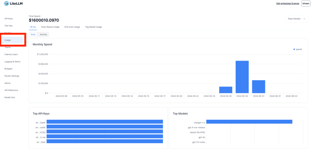
Print 12. Aba Usage do LiteLLM: gasto mensal, top chaves e top modelos, com abas por time, usuário final e tag.

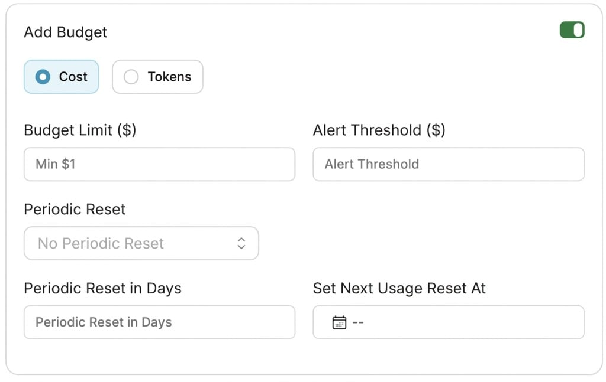
Print 13. Portkey: orçamento por chave em custo ou tokens, com limiar de alerta e reset periódico.

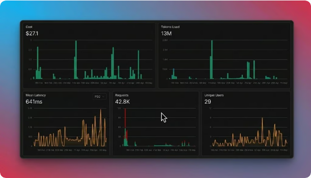
Print 14. Portkey analytics: custo, tokens, latência, requisições e usuários únicos.

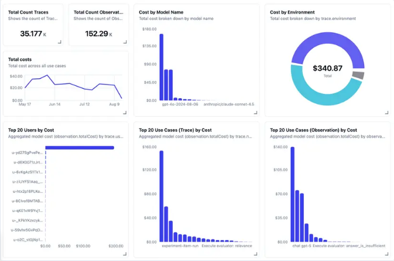
Print 15. Langfuse: custo por modelo, por ambiente, top 20 usuários por custo e top casos de uso.

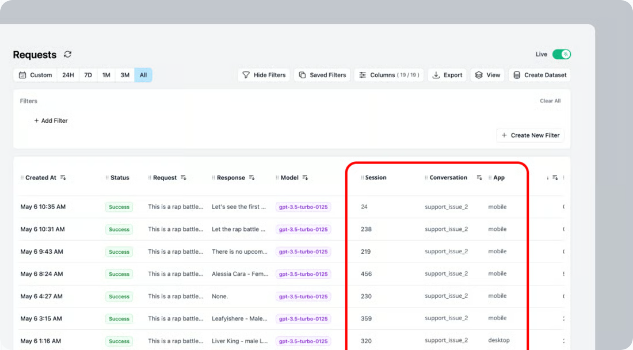
Print 16. Helicone: lista de requisições com propriedades customizadas (sessão, conversa, app) para segmentar o custo.

## Camada 3: governança de SaaS e FinOps de IA

É a única camada que responde "quem na empresa tem conta paga de Claude ou Gemini fora da conta corporativa". Como fazem:

- **Despesas e cartão corporativo**: casam lançamentos de Anthropic, Google, OpenAI com o funcionário que pagou.
- **SSO e OAuth**: veem logins com Google ou Microsoft em claude.ai, gemini.google.com, chatgpt.com.
- **Extensão de navegador ou agente no endpoint**: detectam o acesso a sites de IA mesmo com login pessoal, classificando a intenção sem guardar o texto do prompt.
- **APIs dos fornecedores**: puxam a Analytics API do Claude, a Admin API da OpenAI, o billing do Google Cloud e da AWS para trazer tokens e dólar.

Principais nomes:

- **CloudEagle**: consolida Claude, ChatGPT, Gemini, Cursor e Copilot em um painel por usuário, chave de API, projeto e intenção, com limite de gasto por usuário enviado ao fornecedor, chargeback por departamento, previsão de gasto e reconciliação de fatura.
- **Torii**: descoberta de shadow AI por SSO, navegador e finanças. Atribui assento e tokens a pessoas e times, aponta assinaturas sobrepostas (Copilot, Claude e Gemini ao mesmo tempo) e contas abertas com e-mail pessoal.
- **Zylo**: parte dos dados financeiros e de contas a pagar. Mais forte para contratos e renovações, menos para uso por pessoa.
- **Vantage, Finout, CloudZero**: FinOps. O Vantage lê a Analytics API do Claude Enterprise e mostra custo por desenvolvedor, modelo e produto ao lado de AWS, GCP e OpenAI, com anomalias e previsão.
- **Nudge Security**: descoberta sem agente, foco em segurança, com histórico de gasto SaaS.
- **Credal**: camada de governança que registra prompts e respostas de todos os modelos, com custo como subproduto.

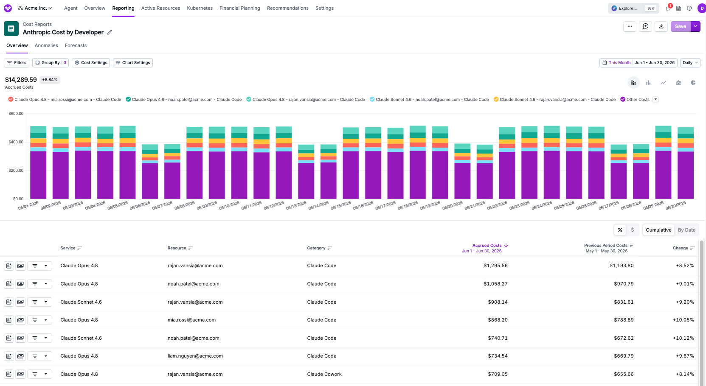
Print 8. Vantage: relatório "Anthropic Cost by Developer" com custo diário por e-mail, modelo e produto, comparando com o mês anterior.

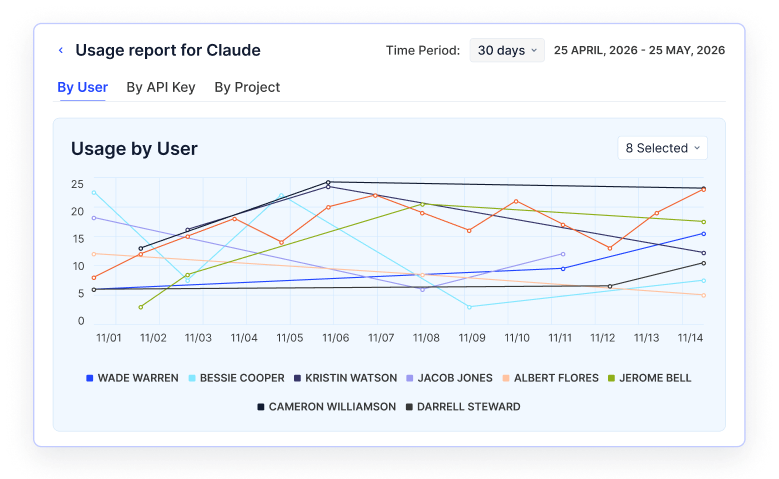
Print 9. CloudEagle: uso do Claude por usuário, com abas por chave de API e por projeto.

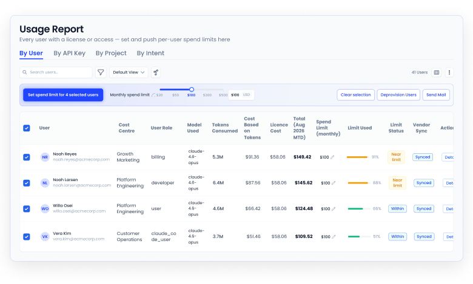
Print 10. CloudEagle: relatório por usuário com centro de custo, modelo, tokens, custo de tokens, custo de licença e limite mensal sincronizado com o fornecedor.

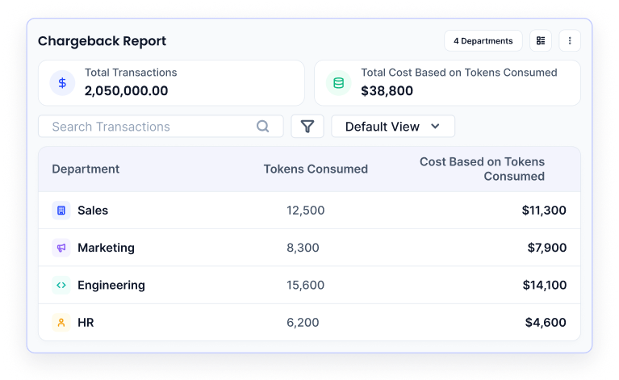
Print 11. CloudEagle: chargeback por departamento com tokens e custo.

## O que nenhuma ferramenta resolve

- **Conta individual é caixa preta.** Anthropic e Google não dão à empresa o uso de um Claude Max ou Gemini Advanced pago no cartão de um funcionário. A camada 3 descobre que a conta existe e quanto custou a assinatura, mas não vê tokens nem conversas. A solução é migrar essas pessoas para Team ou Enterprise.
- **Custo por projeto exige disciplina.** Só aparece se alguém rotulou: grupo SCIM ou projeto no Claude, label no Vertex AI, tag no gateway, centro de custo no RH.
- **Gemini no Workspace não tem custo por pessoa.** É assento fixo. O relatório mostra adoção e quem está parado, o que serve para tirar licença de quem não usa.
- **Os números são estimativas.** Anthropic e os gateways avisam que o painel é analítico e a fatura é a fonte oficial.

## Sugestão de caminho para o cenário que você descreveu

1. Juntar todas as contas Claude pagas pela empresa num único Claude Team ou Enterprise e ligar SCIM com grupos por projeto. Isso já responde quem usa, quanto custa e em qual grupo, com CSV e API.
2. No Google, verificar se as licenças Gemini são do Workspace. Se sim, usar o Gemini reports do Admin Console. Se são Gemini Advanced pessoais, migrar para Workspace.
3. Para uso de API interno, colocar LiteLLM ou Portkey na frente, com uma chave por pessoa e tag por projeto, e orçamento por time.
4. Se a empresa tiver mais de algumas dezenas de pessoas e várias IAs, avaliar uma ferramenta da camada 3 (CloudEagle, Torii ou Vantage) para consolidar e descobrir o que está fora.

## Fontes

- Anthropic, "Giving admins more visibility and control over Claude spend": https://claude.com/resources/articles/giving-admins-more-visibility-and-control-over-claude-usage-and-spend
- Anthropic, usage analytics for Team and Enterprise plans: https://support.claude.com/en/articles/12883420-view-usage-analytics-for-team-and-enterprise-plans
- Anthropic, Claude Enterprise Analytics API: https://platform.claude.com/docs/en/api/admin/analytics
- Anthropic, Claude Code analytics: https://code.claude.com/docs/en/analytics
- Anthropic, Usage and Cost API: https://platform.claude.com/docs/en/build-with-claude/usage-cost-api
- Google, Review Gemini usage in your organization: https://support.google.com/a/answer/14564320
- Google Workspace Updates, Gemini per-app usage reporting: https://workspaceupdates.googleblog.com/2024/12/gemini-per-app-usage-reporting-admin-console.html
- Google Cloud, custom metadata labels on Gemini calls: https://docs.cloud.google.com/vertex-ai/generative-ai/docs/multimodal/add-labels-to-api-calls
- OpenAI, User analytics for ChatGPT Enterprise: https://help.openai.com/en/articles/10875114-user-analytics-for-chatgpt-enterprise-and-edu
- OpenAI, Compliance API vs user analytics: https://help.openai.com/en/articles/11327494-compliance-api-vs-user-analytics-in-chatgpt-enterpriseedu
- Microsoft, Viva Copilot usage and cost insights (MC1400825): https://mc.merill.net/message/MC1400825
- Microsoft, Copilot agent dashboard (MC1166852): https://mc.merill.net/message/MC1166852
- Vantage, support for Claude Enterprise costs: https://www.vantage.sh/blog/anthropic-analytics
- CloudEagle, how enterprises track AI usage, costs and tokens: https://www.cloudeagle.ai/blogs/how-enterprises-track-ai-usage-costs-and-token-consumption
- Torii, 7 tools for AI token usage tracking across vendors: https://www.toriihq.com/articles/seven-tools-for-tracking-ai-token-usage-across-vendors
- Torii, 6 tools to track Claude token usage: https://www.toriihq.com/articles/six-tools-to-track-claude-ai-token-usage
- LiteLLM, spend tracking: https://docs.litellm.ai/docs/proxy/cost_tracking
- Portkey, budget and rate limits: https://portkey.ai/docs/product/administration/enforce-budget-and-rate-limit
- Langfuse, model usage and cost: https://langfuse.com/docs/model-usage-and-cost
- Finout, Anthropic Enterprise Analytics: https://www.finout.io/blog/anthropics-enterprise-analytics
- Worklytics, track LLM token usage and cost by team: https://www.worklytics.co/blog/how-to-track-llm-token-usage-and-cost
- Nudge Security, SaaS spend management tools: https://www.nudgesecurity.com/post/best-saas-spend-management-tools
- Zylo, agentic SaaS management: https://zylo.com/news/zylo-agentic-saas-management
